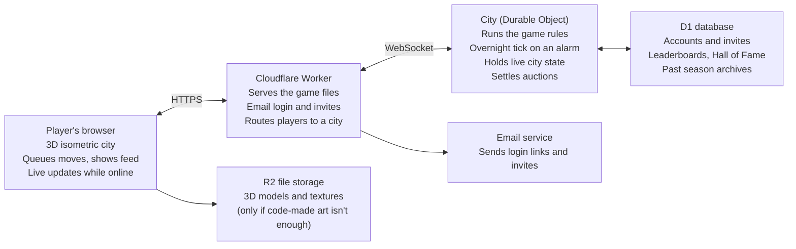
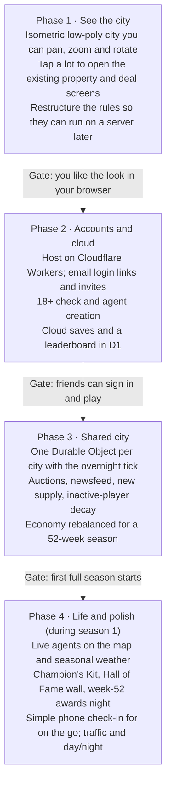

# Real Estate Empire — Game Design Doc

Nov 9, 2026 · Adam

> Living version (with comments): https://claude.ai/artifact/BH9KzNPypRgxp7kKYXqi5N

## Vision

Real Estate Empire is an online, invite-only tycoon game where up to 10 friends compete in one shared isometric city to go from a tent under a bridge to real estate royalty in a single 52-week season.

- **The hook:** one city, ten agents, a year on the market. Buy low in winter, sell high in summer, outbid your friends, and wear the burgundy blazer next season.
- **Tone:** raunchy late-night-infomercial satire of realtor culture: LinkedIn humble-brags, bus-bench ads, gaudy swag. Adults only.
- **Audience:** a private group of friends, by invite link only. No public cities and no matchmaking.
- **Pace:** one check-in a day. Each real day is one game week, so a season runs about 7½ real weeks.
- **Starting point:** the existing single-player game (leads, deals, districts, properties, tenants, rivals, marketing, ranks) becomes the rules engine. The city view and multiplayer are built on top of it.

## Season structure

A season is one realtor's year: 52 game weeks, one per real day, about 7½ real weeks from New Year's to the week-52 awards night.

- **The tick:** the server processes the week overnight. Every queued action resolves at the same moment for everyone.
- **The reset:** after week 52 the city resets. Cash, properties and ranks go back to zero. Only the Hall of Fame and the Champion's Kit carry over.
- **The market quarters** are 13 weeks each, and the map's look changes with them:

| Quarter | Weeks | Market | On the map |
| --- | --- | --- | --- |
| Spring | 1–13 | Heating up: buyers arrive, prices climb | Blossoms, fresh lawns |
| Summer | 14–26 | Peak: bidding wars, top prices, fastest sales | Full green, pools open |
| Fall | 27–39 | Cooling: deals slow, sellers get nervous | Orange leaves |
| Winter | 40–52 | Cold: bargains and motivated sellers, awards in week 52 | Snow, holiday lights |

The core strategy is timing: buy in winter, renovate through spring, and sell into the summer peak.

## Core loop

Each day a player checks in for 5–15 minutes, reacts to what happened overnight, queues the week's moves, and waits for the tick.

1. **Morning report.** The Week Summary shows commission earned, rent collected, tenant drama, auctions won or lost, and the city newsfeed ("Dave just bought the duplex next to your tent").
2. **Walk the city.** Move your agent around the map. Glowing signs mark new listings, foreclosures and empty lots.
3. **Work leads.** Run showings and calls with the existing lead and call-card systems, which turn into closed deals and commission.
4. **Queue moves.** Place offers and auction bids, set rents, order builds and renovations, launch marketing, post brags.
5. **Overnight tick.** The server resolves every player's moves together, settles auctions, applies the market quarter and random events, then writes the next morning's report.

Nothing resolves until the tick, so someone who checks in at 7 a.m. has the same shot as someone at 11 p.m.

## The city

The city is a low-poly 3D map seen from a fixed isometric camera above. You can pan, zoom and rotate it in 90° steps. Simple shapes, flat colours and soft light, all generated in code, so no artist is needed.

- **Districts** from rough to rich, each with its own prices and buyers: the waterfront and industrial flats, downtown, the suburbs, and the hills. They build on the existing `districts` data.
- **Lots** are the unit of play. Each lot is empty, listed for sale, owned by a player, or owned by the bank.
- **Under the bridges and overpasses** are special lots where anyone can pitch a tent. That's how every player starts.
- **Ownership** shows on the map: each player has a colour and a yard sign or flag. Your own holdings are highlighted.
- **Your agent** is an avatar you walk around the city. Tapping a lot opens its card: price, condition, owner, and actions such as offer, lowball, flip or rent out.
- **Life on the street:** other players' agents appear when they're online. Seasonal weather follows the market quarter. Traffic and day/night come later.
- **Desktop first:** the game is a browser app built for a laptop or desktop screen, mouse and keyboard. A simple phone check-in comes in a later phase.

## Property and economy

Money comes from two engines: agent commission from closing deals, and owning property you flip, rent or build up. The game is about moving from the first engine to the second.

**The property ladder.** Each step is a visible building on the lot, so your progress shows on the map:

| Step | How you get it | What it earns |
| --- | --- | --- |
| Tent under a bridge | Free to pitch at the start | Rent from other campers, street cred |
| Shack or fixer-upper | Bought cheap, often in winter | Flip after renovating |
| House or duplex | Bought or built on an empty lot | Steady rent, tenant drama |
| Condo block | Built on combined lots | Many tenants, big rent |
| Tower | Late-season build in a rich district | Prestige and the biggest rent |

**Ways to make money:**

- **Close deals** as an agent (existing leads, calls and commission).
- **Flip:** buy, renovate, and sell into a hotter quarter.
- **Rent:** long-term tenants, or short-term rentals (existing tenant and short-stay systems).
- **Build:** develop empty lots and upgrade buildings step by step.
- **Market:** ads, bus benches and social posts drive leads and reputation (existing marketing and posting systems).

**Rebalance for 52 weeks.** The existing economy was tuned for open-ended solo play. It needs retuning so a strong player goes from tent to tower in one season, and every daily tick feels like progress.

## Multiplayer and competition

Up to 10 friends share one city that keeps running when they're offline. Every listing is real competition: if two people want it, there's a bidding war.

- **Auctions:** when more than one player bids on a listing, it becomes a 24-hour sealed auction, settled at the next tick. The highest bid wins and the loser hears about it in the newsfeed.
- **Unopposed offers** go through at the tick if the seller accepts, using the existing close formula.
- **New supply** keeps coming all season: fresh listings, foreclosures, bank auctions and newly zoned lots, so nobody gets locked out.
- **Newsfeed:** every big move is posted to the city feed, with snark. Who bought what, who got outbid, who got sued by a tenant.
- **Rivalries:** the game tracks who outbids whom most often and calls out the grudge matches.
- **Leaderboard:** net worth ranks the city every week. The week-52 leader is the season champion.
- **Inactive players:** properties left untended decay. After a stretch of missed check-ins, they slide toward foreclosure and come back on the market.
- **Live presence:** players online at the same time see each other's agents walking the map.

## Champion's Kit and Hall of Fame

Last season's champion plays the whole next season in the Champion's Kit, so everyone can spot them across the city. It's the game's version of the Masters green jacket.

- **The burgundy blazer:** obnoxious, gaudy, with shoulder pads that could stop a door.
- **The haircut:** big, sculpted and shiny, with a name like "The Closer" or "The Commission."
- **Crocodile boots:** every step announces you.
- **Fanfare:** the newsfeed makes a fuss whenever the champ wins an auction or walks into a showing.
- **Hall of Fame wall:** every past champion keeps a portrait in full kit, with their season stats.
- **Awards night in week 52:** the champion is crowned, along with roast awards for the rest of the group (most outbid, worst landlord, biggest flop).

## Accounts and access

Players sign in with an emailed login link, with no passwords, and can only join a city through an invite from its owner.

1. **Invite:** the city owner sends a personal invite link to each friend.
2. **Sign in:** the friend enters their email, gets a login link, and clicks it.
3. **18+ check:** a one-time confirmation that they're an adult, because the writing is raunchy.
4. **Create your agent:** name, look and starting character (existing character select), then the agent appears under a bridge with a tent.

The login stays active in the browser, so a daily check-in is one click. The game needs an email-sending service for the login links.

## Tech architecture

The whole game runs on your Cloudflare Workers Paid plan ($5/month). The city's rules run on the server, so nobody can cheat by editing their browser.

- **Server-run rules:** the existing game logic is pure TypeScript with a single source of randomness, so it can move into the Durable Object almost unchanged. The browser only displays the city and sends moves.
- **The tick:** a Durable Object alarm fires once a night and runs the week for every player at once.
- **Low cost:** hibernating WebSockets mean an idle city costs almost nothing. Ten friends should fit within the $5 plan.
- **Saves:** the live city lives in the Durable Object's own storage. D1 holds accounts and everything that outlasts a season.

## Build phases

The city view comes first, because the look is what makes friends want to play. Multiplayer is built on top once the look is approved.

Each gate is a check-in with you before the next phase starts. Phase 4 can carry on while the first season is running, as long as the Champion's Kit is ready by week 52.

## Open questions

- [ ] Which browsers must it support (Chrome, Safari, Edge, Firefox)?
- [ ] What time does the overnight tick run, and in which time zone?
- [ ] Starting cash and the money targets for tent-to-tower in 52 weeks (rebalancing pass).
- [ ] Which email service sends the login links?
- [ ] Is there any chat between players, or only the newsfeed?
- [ ] What counts as "inactive," and how fast do neglected properties decay?
- [ ] Does the city keep the same map every season, or get a new layout?
